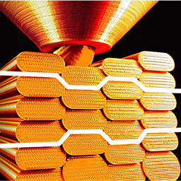

# BrickLayers Web
[]()
<a href="https://github.com/pedromxavier/flag-badges">
    
</a>&nbsp;

Interfaz web local para configurar, previsualizar y aplicar BrickLayers desde OrcaSlicer.

&nbsp;

## Donaciones
Puedes hacer una aportación en:
[](https://www.paypal.com/donate/?hosted_button_id=TSCH5FJDVYWP6)

Gracias.

## Proyecto original

&nbsp;

Este proyecto se basa en [BrickLayers, de GeekDetour](https://github.com/GeekDetour/BrickLayers), un postprocesador de G-code de capas entrelazadas para PrusaSlicer, OrcaSlicer y Bambu Studio.

El algoritmo de transformación pertenece al proyecto original. `bricklayers_web.py` añade la interfaz gráfica, el servidor local, la previsualización y la integración interactiva; ejecuta `bricklayers.py`, no lo sustituye.

- Proyecto original: https://github.com/GeekDetour/BrickLayers
- Autor original: https://github.com/GeekDetour
- Vídeo explicativo: https://www.youtube.com/watch?v=qqJOa46OTTs

La integración documentada aquí está orientada a OrcaSlicer. La compatibilidad del motor original con otros laminadores no implica que esta interfaz se haya probado con todos ellos.

## Ventajas de BrickLayers Web

&nbsp;

- Revisar el resultado en un visor 3D durante el postprocesado, sin volver a importar manualmente el G-code para cada comprobación.
- Cambiar la capa inicial, el multiplicador de extrusión y la activación desde «Parámetros».
- Regenerar la previsualización al cambiar los ajustes.
- Mostrar u ocultar paredes internas originales, recorridos BrickLayers y otras extrusiones.
- Inspeccionar el modelo hasta una altura mediante el deslizador vertical, con número de capa, total y coordenada Z.
- Consultar una miniatura incluida en el G-code, cuando está disponible y es compatible.
- Aplicar el resultado y continuar en OrcaSlicer mediante «Aplicar y cerrar».
- Devolver el G-code original sin el efecto BrickLayers cuando se desactiva el procesamiento.

## Requisitos e instalación

- Python 3.
- Flask y Pillow.
- Navegador con WebGL.
- `bricklayers.py` junto a `bricklayers_web.py`.
- Recursos locales de Three.js en `static/`, con sus dependencias y rutas relativas. Todos deben corresponder a una misma versión.
- G-code de texto, no binario.

Instala las dependencias con el mismo intérprete que utilizará el laminador:

```bash
python -m pip install Flask Pillow
```

En sistemas donde corresponda, utiliza `python3` en lugar de `python`.

Estructura:

```text
BrickLayers/
├── bricklayers.py
├── bricklayers_web.py
├── README.md
├── LICENSE
└── static/
    ├── three.module.js
    └── controls/
        └── OrbitControls.js
```

## Configuración en OrcaSlicer

### Comando mínimo

En «Scripts de postprocesado» basta con indicar el intérprete y el script:

```text
"C:\Ruta\Python\python.exe" "D:\BrickLayers\bricklayers_web.py"
```

No es necesario pasar los parámetros. Se utilizan automáticamente estos valores:

```text
-startAtLayer 3 -extrusionMultiplier 1.05 -enabled 1
```

Adapta las rutas a tu instalación. OrcaSlicer añade la ruta del G-code temporal: no escribas manualmente un archivo de entrada en esta configuración.

En Linux o macOS, un ejemplo equivalente sería:

```text
/usr/bin/python3 "/ruta/BrickLayers/bricklayers_web.py"
```

No añadas además otro postprocesador que ejecute `bricklayers.py` sobre el mismo archivo: la interfaz ya llama al motor original.

### Cambiar los parámetros

Puedes hacerlo de dos formas:

1. Al lanzar `bricklayers_web.py`, añadiendo únicamente los argumentos que quieras cambiar.
2. Dentro de la interfaz gráfica, pulsando «Parámetros».

Ejemplo con valores de arranque personalizados:

```text
"C:\Ruta\Python\python.exe" "D:\BrickLayers\bricklayers_web.py" -startAtLayer 5 -extrusionMultiplier 1.03 -enabled 1
```

Los argumentos que omitas conservan su valor predeterminado. Los cambios realizados en la interfaz se aplican a la sesión actual; no modifican automáticamente el comando guardado en el laminador.

### Preparar el laminado

Siguiendo las recomendaciones del proyecto original:

- Utiliza el orden de paredes Interior/Exterior (`Inner/Outer`).
- En OrcaSlicer se recomienda el generador Clásico (`Classic`); el proyecto original advierte de posibles problemas con bucles generados por Arachne.
- Desactiva el ajuste a arcos (`Arc fitting`).
- Utiliza G-code de texto. En PrusaSlicer, desactiva el G-code binario para este flujo.

## Flujo de uso

1. Lamina y exporta o envía mediante un flujo que ejecute los scripts de postprocesado.
2. Espera a que se abra BrickLayers Web y se prepare el visor.
3. Pulsa «Parámetros» si quieres cambiar los ajustes.
4. Inspecciona el modelo con rotación, desplazamiento, zoom y el deslizador de capas.
5. Activa o desactiva las categorías de recorridos que quieras comparar.
6. Pulsa «Aplicar y cerrar» para escribir el resultado y permitir que continúe OrcaSlicer.

OrcaSlicer espera mientras la aplicación está abierta. Cerrar solamente la ventana del navegador no equivale a aplicar el resultado y puede dejar el proceso esperando.

## Parámetros disponibles

| Parámetro | Predeterminado | Función |
| --- | --- | --- |
| `-startAtLayer` | `3` | Capa inicial que se pasa al motor BrickLayers. |
| `-extrusionMultiplier` | `1.05` | Multiplicador de extrusión del motor original. |
| `-enabled` | `1` | `1`: activar; `0`: devolver el original sin el efecto. |
| `--port` | `5000` | Puerto del servidor local. |
| `--no-browser` | Desactivado | Evita abrir automáticamente el navegador. |

Los tres primeros pueden cambiarse desde «Parámetros». `--port` y `--no-browser` son opciones de lanzamiento.

La numeración visible del visor comienza en 1 y no debe confundirse con la interpretación interna de `-startAtLayer` en el motor original.

## Visor, capas y dimensiones

La versión volumétrica representa los recorridos como cordones. Sus anchos nominales y alturas se leen del bloque `CONFIG_BLOCK_START … CONFIG_BLOCK_END`, cuando está disponible; los porcentajes de ancho se resuelven respecto al diámetro de boquilla.

Para el original se consulta un comentario como:

```gcode
; total layers count = 20
```

Si no existe, se calculan las alturas de deposición detectadas. Para el resultado BrickLayers se recalculan siempre, incluyendo las intermedias y excluyendo los saltos Z sin deposición. La etiqueta muestra la capa seleccionada, el total del visor y su Z.

El recuento de alturas puede diferir del número de capas lógicas del slicer, por ejemplo si existe una purga a otra altura. La miniatura identifica el modelo, pero no es una imagen recalculada del resultado BrickLayers.

## Ejecución manual

Puedes abrir un archivo fuera del laminador:

```bash
python bricklayers_web.py "pieza.gcode"
```

También puedes pasar ajustes opcionales:

```bash
python bricklayers_web.py -startAtLayer 5 --port 5001 "pieza.gcode"
```

«Aplicar y cerrar» sustituye el archivo de entrada. Haz las pruebas con una copia.

El servidor se ejecuta localmente en `127.0.0.1`. Si utilizas `--no-browser`, abre la dirección indicada en la terminal, normalmente `http://127.0.0.1:5000`.

En Windows intenta abrir Edge en una ventana de aplicación; si no está disponible, recurre al navegador predeterminado.

## Limitaciones y resolución de problemas

- El visor no es una simulación física ni garantiza resistencia, adhesión o ausencia de colisiones.
- El parser está orientado a movimientos lineales `G0/G1`; no interpreta todos los dialectos de firmware ni arcos `G2/G3`.
- Las dimensiones nominales no reproducen necesariamente capas variables ni todas las variaciones locales de extrusión.
- La comparación por Z no es completa si existen alturas originales ausentes del resultado procesado.
- En archivos grandes puede simplificarse la geometría visible; el G-code final no se recorta por ello.
- El servicio está pensado para una sesión local, no para uso multiusuario.

Si falta `bricklayers.py`, colócalo junto al script web. Si faltan dependencias, instálalas con el Python configurado en el laminador. Si falla el visor, comprueba WebGL, la consola del navegador y los módulos de `static/`. Si el puerto está ocupado, utiliza `--port` con otro valor.

## Licencia
[](LICENSE)

BrickLayers Web (`bricklayers_web.py`) se distribuye bajo la GNU General Public License, versión 3 exclusivamente (`GPL-3.0-only`). Consulta [LICENSE](LICENSE) para leer el texto completo.

Puedes utilizar, estudiar, modificar y redistribuir el programa conforme a sus condiciones. Se proporciona sin garantía, en los términos establecidos en la licencia.

El motor BrickLayers original conserva sus avisos de autoría y licencia. La licencia de BrickLayers Web no sustituye los avisos ni las licencias de las dependencias de terceros, que deben conservarse al redistribuirlas.

Gracias a GeekDetour por el proyecto original y el algoritmo sobre el que se apoya esta interfaz.
